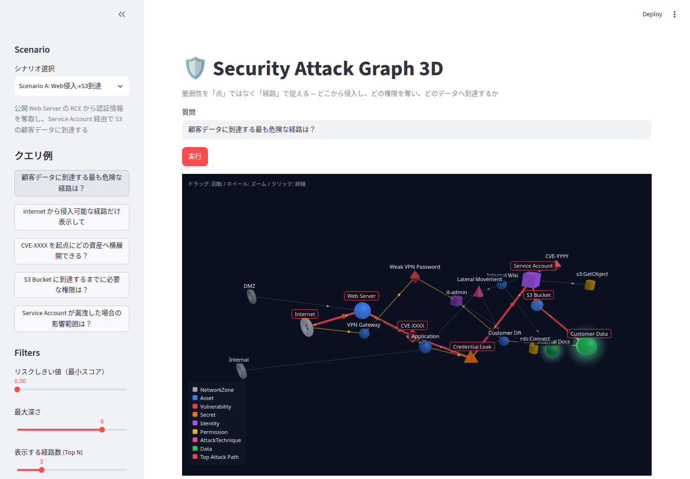

# Security Attack Graph 3D

資産・脆弱性・権限・シークレット・データを知識グラフ化し、
**「どの脆弱性が危険か」ではなく「どの経路で顧客データまで到達できるか」** を 3D で可視化するデモ。



```
Streamlit UI ──HTTP──▶ FastAPI ──▶ Intent (vLLM + Qwen / ルールベース)
     │                    │
     │                    └──▶ Attack Path Engine ──▶ Neo4j（またはインメモリ）
     └── Three.js 3D ビュー（経路ハイライト・ノード詳細）
```

## クイックスタート

前提: Python 3.11+, [uv](https://docs.astral.sh/uv/), Docker（Neo4j 用）。vLLM は任意。

```bash
uv sync

# 1. LLM（任意。無くてもルールベース解析 + テンプレート説明で動く）
./scripts/run_vllm.sh                  # Qwen/Qwen3-1.7B を :8001 で起動

# 2. バックエンド（Neo4j 起動 → seed → FastAPI :8010）
./scripts/run_backend.sh
#   Neo4j なしで動かす場合: GRAPH_BACKEND=memory ./scripts/run_backend.sh

# 3. UI
./scripts/run_streamlit.sh             # http://localhost:8501
```

## 設定（環境変数）

| 変数 | 既定値 | 説明 |
|---|---|---|
| `GRAPH_BACKEND` | `neo4j` | `memory` にするとインメモリグラフ（Neo4j 不要） |
| `NEO4J_URI` / `NEO4J_USER` / `NEO4J_PASSWORD` | `bolt://localhost:17687` / `neo4j` / `attackgraph` | 7474/7687 は他プロジェクトと衝突しやすいので 17474/17687 |
| `LLM_ENABLED` | `1` | `0` で LLM を使わない |
| `VLLM_BASE_URL` / `VLLM_MODEL` | `http://localhost:8001/v1` / `Qwen/Qwen3-1.7B` | OpenAI 互換エンドポイント |
| `LLM_DISABLE_THINKING` | `1` | Qwen3 の thinking 出力を抑止 |
| `BACKEND_URL` | `http://localhost:8010` | Streamlit から見たバックエンド |

## LLM の評価

```bash
uv run python scripts/eval_llm.py   # デモ質問 7 問の intent 正答率・解説のノード名カバー率
```

| モデル | intent | 解説（ポストチェック通過） |
|---|---|---|
| Qwen3-1.7B（既定） | 7/7 | 7/7 |
| Qwen2.5-1.5B-Instruct | 7/7 | 3/7 |

## テスト

```bash
uv run pytest            # Neo4j が起動していれば Neo4j 実装も同じテストで検証、無ければ skip
```

## ディレクトリ

```
backend/
  models/      ontology.py（ノード・エッジ種別の正本） / schemas.py
  services/    graph_service（Neo4j・インメモリ） / path_service / scoring_service
               cypher_builder / cypher_guard / intent_service / llm_service / summary_service
               query_service（全体の組み立て） / factory
  api/         query / graph / seed
  prompts/     LLM プロンプト
app/
  streamlit_app.py
  components/  view_model（3D レイアウト） / graph_viewer / summary_panel / node_detail / presenters
  static/threejs/
data/seed/     scenario_a.yaml（Web侵入→S3） / scenario_b.yaml（API Key 漏洩） / scenario_c.yaml（認可過剰）
docker/        docker-compose.yml（Neo4j）
scripts/       run_*.sh / seed_neo4j.py
```

## ドキュメント

- [設計書](docs/security_attack_graph_3d_design.md)
- [オントロジーとスコアリング](docs/ontology.md)
- [API 仕様](docs/api_spec.md)
- [デモ台本](docs/demo_script.md)
- [TODO / 進捗](todo.md)

## 既知の制約

[Issues](https://github.com/mutomasa/security-attack-graph-3d/issues) を参照。主なもの:

- Neo4j Community Edition では読み取り専用ユーザーを作れない → READ access mode + Cypher ガードレールで代替（#2）
- 設計書のスコア式から影響度の集計を max に変更（#4）
- 小型 Qwen の説明文はハルシネーションすることがある → テンプレート説明と AI 解説を分けて表示（#7）
- 3D ビューのクリックを Streamlit に返せない → ビュー内の詳細パネル + selectbox で代替（#10）
