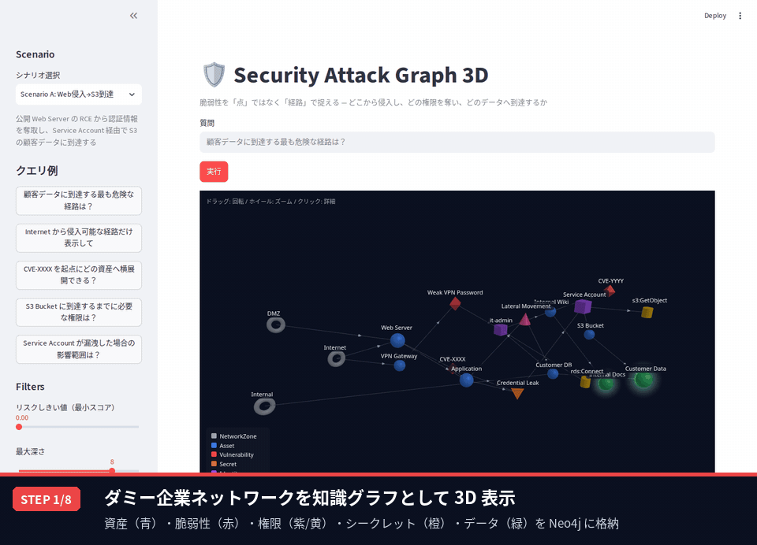
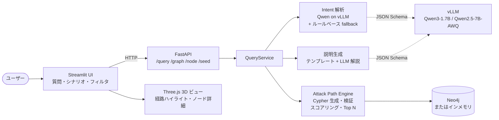
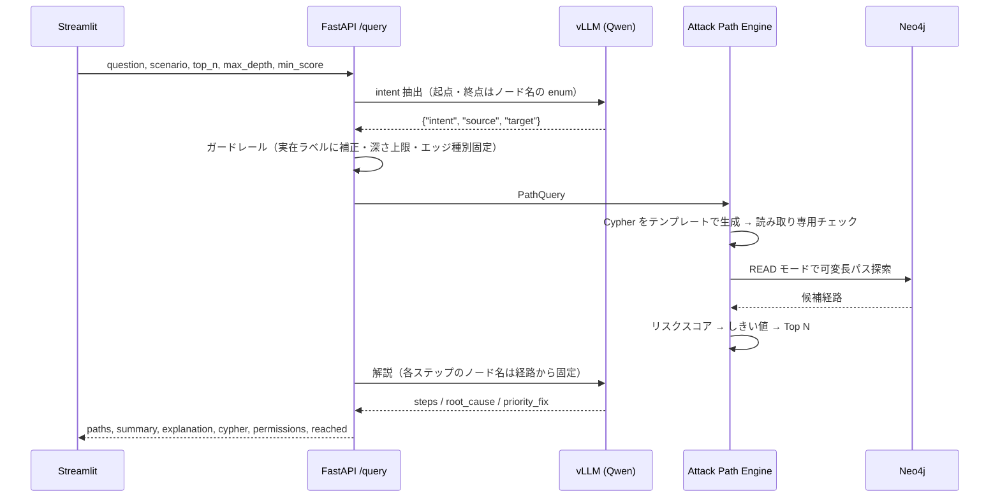

# Security Attack Graph 3D

企業システムの **資産・脆弱性・権限・シークレット・データ** を知識グラフとして表現し、
**「どの脆弱性が危険か」ではなく「どの経路で顧客データまで到達できるか」** を
自然言語で質問して 3D で確かめられるデモ / プロトタイプです。



> GIF の各ステップの内容は [デモの流れ](#デモの流れ) を参照してください。
> GIF は `scripts/record_demo.py` で起動中のアプリを Playwright が自動操作して撮影し、字幕を付けたものです。

---

## 目次

- [背景と狙い](#背景と狙い)
- [主な機能](#主な機能)
- [デモの流れ](#デモの流れ)
- [アーキテクチャ](#アーキテクチャ)
- [知識グラフ（オントロジーとシナリオ）](#知識グラフオントロジーとシナリオ)
- [攻撃経路の探索とリスクスコア](#攻撃経路の探索とリスクスコア)
- [LLM の使い方（Qwen + vLLM）](#llm-の使い方qwen--vllm)
- [3D 可視化](#3d-可視化)
- [API](#api)
- [セットアップと起動](#セットアップと起動)
- [設定（環境変数）](#設定環境変数)
- [LLM の評価](#llm-の評価)
- [開発](#開発)
- [既知の制約と今後](#既知の制約と今後)

---

## 背景と狙い

脆弱性スキャナは CVE を何百件も並べますが、**どれから直すべきか**は分かりません。
CVSS が高い脆弱性でも重要データにつながっていなければ優先度は低く、
逆に中程度の設定不備が認証情報の漏洩を経由して顧客データに直結していることもあります。

本プロジェクトは脆弱性を「点」ではなく「経路」で捉えます。

> どこから侵入し、どの権限を奪い、最終的にどのデータへ到達するか

これをグラフで示し、経営層・現場の両方が同じ図を見て対策の優先順位を合意できる状態を目指しています。
設計の詳細は [設計書](docs/security_attack_graph_3d_design.md) にあります。

## 主な機能

| 機能 | 内容 |
|---|---|
| 知識グラフ | ダミー企業 3 社分のネットワークを Neo4j に格納（ノード 8 種・エッジ 11 種のオントロジー） |
| 自然言語で質問 | 「顧客データに到達する最も危険な経路は？」などを Qwen が解釈し、検索条件に変換 |
| 攻撃経路探索 | Cypher の可変長パスで候補経路を列挙（ノード再訪なし・深さ上限付き） |
| リスクスコア | 脆弱性の深刻度 × 悪用容易性、奪われる権限、データの重要度、経路長から経路を順位付け |
| 3D 可視化 | Three.js で全体グラフを表示し、Top 1 経路を赤い太線と流れる光でハイライト |
| 説明 | グラフから組み立てる正確な説明文 + LLM による解説（ノード名は guided decoding で固定） |
| 詳細表示 | 3D 上のノードをクリックすると隣接ノードを強調し、属性・権限を表示 |
| 安全性 | LLM に Cypher を書かせない、読み取り専用の検証、READ モード実行、入力検証 |
| LLM なしでも動作 | vLLM が無い・落ちている場合はルールベース解析とテンプレート説明に自動で切り替え |

質問は 4 種類の意図（intent）に分類されます。

| intent | 質問の例 | 返すもの |
|---|---|---|
| `find_highest_risk_path` | 顧客データに到達する最も危険な経路は？ | 上位 N 経路 |
| `list_attack_paths` | Internet から侵入可能な経路だけ表示して | 条件に合う経路の一覧（最低 10 件） |
| `blast_radius` | Service Account が漏洩した場合の影響範囲は？ / CVE-XXXX を起点にどこへ横展開できる？ | 起点から到達できる資産・データ・権限 |
| `required_permissions` | S3 Bucket に到達するまでに必要な権限は？ | Top 1 経路上の Identity が持つ権限 |

## デモの流れ

GIF は以下の 8 ステップです（実際の推論待ち 5〜10 秒は GIF では短縮しています）。

| STEP | 画面 | 見どころ |
|---|---|---|
| 1 | シナリオ A の全体グラフ | 左（Internet）から右（Customer Data）へ、攻撃が進む向きにノードを配置。ドラッグで回転 |
| 2 | クエリ例「顧客データに到達する最も危険な経路は？」 | Qwen2.5-7B（vLLM）が意図・起点・終点を解釈 |
| 3 | 赤い経路のハイライト | Internet → Web Server → CVE-XXXX → Credential Leak → Service Account → S3 Bucket → Customer Data |
| 4 | 結果サマリ | スコア 16.19、6 ホップ。説明文はグラフから組み立てるので常に正確 |
| 5 | AI 解説 | 各ノードで起きること、根本原因、最優先で塞ぐ箇所。ノード名は経路から固定 |
| 6 | 経路一覧とスコア内訳 | 2 位 Application 経由、3 位 VPN 経由。スコアの内訳で「なぜ危険か」を説明できる |
| 7 | 3D 上で Service Account をクリック | 隣接ノードだけを強調し、権限 `s3:GetObject` などの属性を表示 |
| 8 | シナリオ C（認可過剰）に切り替え | Internal User → Excessive Trust Policy → Privilege Escalation → Over-privileged Role → Data Lake → Sensitive Table |

口頭で説明する場合の台本は [docs/demo_script.md](docs/demo_script.md) にあります。

## アーキテクチャ



質問 1 件の処理の流れは次のとおりです。



| レイヤ | 技術 | 主なファイル |
|---|---|---|
| UI | Streamlit 1.66, Three.js 0.160 | `app/streamlit_app.py`, `app/components/`, `app/static/threejs/` |
| API | FastAPI | `backend/main.py`, `backend/api/` |
| 探索・スコア | Cypher / networkx | `backend/services/cypher_builder.py`, `path_service.py`, `scoring_service.py` |
| LLM | vLLM（OpenAI 互換 API）+ Qwen | `backend/services/llm_service.py`, `intent_service.py`, `summary_service.py`, `guided_schemas.py` |
| ガードレール | 自前の Cypher 検証 | `backend/services/cypher_guard.py` |
| グラフ DB | Neo4j 5.23（Docker） | `backend/services/graph_service.py`, `docker/docker-compose.yml` |

`GraphRepository` は Neo4j 実装とインメモリ（networkx）実装を持ち、同じテストで両方を検証しています。
Neo4j が無い環境でも `GRAPH_BACKEND=memory` でデモ全体が動きます。

## 知識グラフ（オントロジーとシナリオ）

定義の正本は `backend/models/ontology.py`、説明は [docs/ontology.md](docs/ontology.md) にあります。

| ノード種別 | 例 | スコアに使う属性 | 3D 表現 |
|---|---|---|---|
| Asset | Web Server, S3 Bucket | `criticality` 1〜5 | 青・球 |
| Vulnerability | CVE-XXXX, Weak VPN Password | `severity` 0〜10, `exploitability` 0〜1 | 赤・八面体 |
| Identity | Service Account, Over-privileged Role | `privilege` 1〜5 | 紫・立方体 |
| Permission | s3:GetObject, AssumeRole | — | 黄・円柱 |
| Secret | Credential Leak, CI Deploy API Key | — | 橙・四面体 |
| Data | Customer Data, Sensitive Table | `confidentiality_impact` 1〜5 | 緑・発光球 |
| NetworkZone | Internet, DMZ, Internal | — | 灰・トーラス |
| AttackTechnique | Lateral Movement, Privilege Escalation | `mitre_id` | ピンク・円錐 |

エッジは `EXPOSED_TO`, `HAS_VULNERABILITY`, `LEADS_TO`, `CAN_ACCESS`, `STORES` など 11 種類です。
このうち `HAS_PERMISSION` と `PROTECTS` は「状態」を表すので、攻撃経路としては辿りません。

シナリオは `data/seed/*.yaml` で管理しており、差し替えや追加ができます。
どのシナリオにも、ランキングの比較ができるよう代替経路とダミー資産を入れています。

| シナリオ | 内容 | ノード / エッジ | Top 1 経路（スコア） |
|---|---|---|---|
| A: Web 侵入 → S3 到達 | 公開 Web Server の RCE から認証情報を奪い S3 へ | 20 / 23 | Internet → Web Server → CVE-XXXX → Credential Leak → Service Account → S3 Bucket → Customer Data（16.19） |
| B: API Key 漏洩 | 公開リポジトリのハードコード API Key から CI/CD・クラウドロールを奪取 | 16 / 20 | Internet → GitHub Repo → Hardcoded Secret → CI Deploy API Key → Cloud Deploy Role → Customer DB → Customer Data（16.79） |
| C: 認可過剰 | 過剰な信頼ポリシーで強権限ロールを引き受ける | 13 / 13 | Internal User → Excessive Trust Policy → Privilege Escalation → Over-privileged Role → Data Lake → Sensitive Table（16.00） |

## 攻撃経路の探索とリスクスコア

**探索**: `PathQuery`（起点・終点 or 終点の種別・エッジ種別・最大深さ）から Cypher をテンプレートで生成します。

```cypher
MATCH p = (start {scenario: $scenario})
  -[:EXPOSED_TO|HOSTS|HAS_VULNERABILITY|CAN_EXPLOIT|CAN_ACCESS|USES_SECRET|LEADS_TO|CAN_REACH|STORES*1..8]->
  (target {scenario: $scenario})
WHERE (start.label = $source OR start.id = $source)
  AND (target.label = $target OR target.id = $target)
  AND all(n IN nodes(p) WHERE single(m IN nodes(p) WHERE m = n))   -- ノード再訪を除外
RETURN ...
```

ユーザーの値はすべてパラメータで渡し、文字列に埋め込むのは Enum 由来の識別子と上限付きの整数だけです。

**スコア**:

```
score = ( Σ(severity × exploitability)   … 経路上の脆弱性
        + max(privilege)                 … 奪われる最大の権限
        + max(confidentiality_impact)    … 到達するデータの重要度
        + max(criticality) )             … 経由する最重要資産
        × Π(edge weight)                 … 各ステップの成功しやすさ（既定 1.0）
        − 1.0 × ホップ数
```

シナリオ A の Top 1 は 脆弱性 8.19 + 権限 4 + データ 5 + 資産 5 − 6 ホップ = **16.19** です。
内訳は UI の「Top 1 スコア内訳」と API の `score_breakdown` で確認できます。

> 設計書 §9.2 の式は全項目を Σ（合計）しますが、そのままだと余計な資産を経由する長い経路ほどスコアが上がるため、
> 影響度の項目は max で集計しています（[#4](https://github.com/mutomasa/security-attack-graph-3d/issues/4)）。

## LLM の使い方（Qwen + vLLM）

LLM の担当は **質問の意図の解釈** と **解説文** だけです。Cypher は LLM に書かせません。

1. **意図の解釈**: intent（4 種類）と起点・終点を JSON で出力させます。vLLM のガイド付きデコーディングで、
   起点・終点は **シナリオに実在するノード名の enum** に制約されるため、存在しないノードは出力できません。
   質問文にノード名が明示されている場合はそれを優先し（「顧客データ」→ Customer Data などの日本語エイリアスあり）、
   LLM には intent の種類だけを判定させます。最大深さとエッジ種別は LLM に決めさせません。
2. **解説**: 経路の各ノードを順番どおりに固定した JSON Schema（`prefixItems` + `const`）で出力させます。
   LLM が書けるのは「そのノードで何が起きるか」「根本原因」の説明文だけで、
   「最優先で塞ぐべき箇所」も経路上のノード名の enum から選びます。
   そのため、小型モデルでよく起きるノード名の和訳・取り違え・経路外ノードの持ち出しが構造的に起きません。
3. **フォールバック**: vLLM が無い・タイムアウト・不正な出力の場合、意図の解釈はルールベース、
   説明はテンプレートに自動で切り替わります。テンプレートの説明文は LLM の有無に関係なく常に表示します。

**ガードレール**（設計書 §10.3, §18.3）

- Cypher はテンプレートから生成し、実行前に `cypher_guard` で CREATE / MERGE / DELETE / SET / CALL / LOAD / 複数文 / 許可外のラベル・エッジ / 無制限・深すぎる可変長パスを拒否
- Neo4j へは READ access mode のセッションで実行（Community 版は読み取り専用ユーザーを作れないための代替。[#2](https://github.com/mutomasa/security-attack-graph-3d/issues/2)）
- 質問は 1〜500 文字、深さは最大 10、Top N は最大 50

プロンプトは `backend/prompts/` に分離しています。

## 3D 可視化

- **配置**: 侵入口からの BFS 深さを x 軸に取るレイヤードレイアウト（攻撃が左から右へ進む）。同じ層は円周上に並べ、層ごとに位相をずらして重なりを減らしています
- **経路**: Top 1 は赤い太いチューブと流れる光、Top 2〜3 は細いオレンジ線、その他は薄い線と矢印
- **操作**: ドラッグで回転、ホイールでズーム、ホバーでツールチップ、クリックで隣接ノード以外を減光し詳細パネルを表示
- **実装**: レイアウトと見た目の決定は Python（`app/components/view_model.py`、単体テストあり）、描画とインタラクションは JS（`app/static/threejs/graph_viewer.js`）

## API

起動後、OpenAPI ドキュメントは http://localhost:8010/docs で見られます。詳細は [docs/api_spec.md](docs/api_spec.md) にあります。

| Method | Path | 内容 |
|---|---|---|
| POST | `/query` | 自然言語の質問 → intent・Cypher・経路（スコア内訳付き）・説明・AI 解説・権限・到達ノード |
| GET | `/graph/scenario/{id}` | シナリオ全体のグラフ |
| GET | `/node/{id}?scenario=` | ノード詳細と入出力エッジ・隣接ノード |
| POST | `/seed` | シナリオ YAML を投入（シナリオ単位で置き換え） |
| GET | `/scenarios` / `/ontology` / `/health` | シナリオ一覧 / 種別の説明 / ヘルスチェック |

```bash
curl -s -X POST localhost:8010/query -H 'content-type: application/json' \
  -d '{"question": "顧客データに到達する最も危険な経路は？", "scenario": "demo_company_a"}'
```

## セットアップと起動

前提: Linux / macOS、Python 3.11+、[uv](https://docs.astral.sh/uv/)、Docker（Neo4j 用）。
LLM を使う場合は vLLM と NVIDIA GPU（開発機は RTX A1000 8GB）が必要です。

```bash
uv sync

# 1. LLM（任意。無くてもルールベース解析 + テンプレート説明で動く）
./scripts/run_vllm.sh                  # Qwen/Qwen3-1.7B を :8001 で起動

# 2. バックエンド（Neo4j 起動 → seed → FastAPI :8010）
./scripts/run_backend.sh
#   Neo4j なしで動かす場合: GRAPH_BACKEND=memory ./scripts/run_backend.sh

# 3. UI
./scripts/run_streamlit.sh             # http://localhost:8501
```

**解説の質を優先する場合（Qwen2.5-7B-Instruct-AWQ）**: GPU 約 7.7GB を使い、応答は 5〜10 秒です。

```bash
VLLM_MODEL=Qwen/Qwen2.5-7B-Instruct-AWQ VLLM_MAX_LEN=2048 VLLM_GPU_UTIL=0.95 \
  VLLM_EXTRA_ARGS=--enforce-eager ./scripts/run_vllm.sh
VLLM_MODEL=Qwen/Qwen2.5-7B-Instruct-AWQ LLM_TIMEOUT=60 ./scripts/run_backend.sh
```

CUDA toolkit（nvcc）が無い環境では、`run_vllm.sh` が FlashInfer のサンプラーを自動で無効化します。

## 設定（環境変数）

| 変数 | 既定値 | 説明 |
|---|---|---|
| `GRAPH_BACKEND` | `neo4j` | `memory` にするとインメモリグラフ（Neo4j 不要） |
| `NEO4J_URI` / `NEO4J_USER` / `NEO4J_PASSWORD` | `bolt://localhost:17687` / `neo4j` / `attackgraph` | 7474/7687 は他プロジェクトと衝突しやすいので 17474/17687 |
| `LLM_ENABLED` | `1` | `0` で LLM を使わない |
| `VLLM_BASE_URL` / `VLLM_MODEL` | `http://localhost:8001/v1` / `Qwen/Qwen3-1.7B` | OpenAI 互換エンドポイント |
| `LLM_TIMEOUT` | `20` | LLM リクエストのタイムアウト（秒）。7B では 60 推奨 |
| `LLM_DISABLE_THINKING` | `1` | Qwen3 の thinking 出力を抑止 |
| `LLM_GUIDED` | `1` | JSON Schema によるガイド付きデコーディング。`0` で自由記述 + ノード名カバー率のポストチェック |
| `BACKEND_URL` | `http://localhost:8010` | Streamlit から見たバックエンド |
| `VLLM_PORT` / `VLLM_MAX_LEN` / `VLLM_GPU_UTIL` / `VLLM_EXTRA_ARGS` | `8001` / `4096` / `0.85` / なし | `run_vllm.sh` の起動オプション |

## LLM の評価

```bash
uv run python scripts/eval_llm.py   # デモ質問 7 問の intent 正答率・解説のノード名カバー率
```

A1000 8GB・自前の vLLM で計測した結果です。

| モデル | intent | 解説: ガイド付き | 解説: 自由記述 | 応答（ガイド付き） | GPU |
|---|---|---|---|---|---|
| Qwen3-1.7B（既定） | 7/7 | 7/7 | 7/7 | 4.3〜7.0s | 約 6.5GB |
| Qwen2.5-7B-Instruct-AWQ | 7/7 | 7/7 | 0/7（ノード名を和訳） | 5.1〜9.6s | 約 7.7GB |
| Qwen2.5-1.5B-Instruct | 7/7 | 未評価 | 3/7 | — | 約 6.5GB |

- 7B-AWQ は自由記述ではノード名を必ず和訳してしまい使えませんでしたが、ガイド付きデコーディングで使えるようになりました。根本原因の説明や塞ぐ箇所の選び方は 7B の方が的確です
- 既定は、速さと GPU の余裕を優先して Qwen3-1.7B にしています。README の GIF は 7B-AWQ で撮影しました

## 開発

```bash
uv run pytest                          # 単体テスト 156 件。Neo4j が起動していれば Neo4j 実装も同じテストで検証、無ければ skip
uv run python scripts/record_demo.py   # README の GIF を再生成（デモ環境の起動が前提）
```

- **テスト**: pytest。リポジトリは memory / Neo4j の両方、LLM は `httpx.MockTransport` とフェイク、UI は Streamlit `AppTest` で検証
- **CI**: GitHub Actions（Neo4j のサービスコンテナ付きで pytest）
- **設計方針**: 関数は小さく、SOLID を意識（`GraphRepository` / `IntentParser` / `Summarizer` は Protocol で差し替え可能）。パッケージ管理は uv
- **進め方**: 機能ごとにブランチ → PR、問題点は [Issues](https://github.com/mutomasa/security-attack-graph-3d/issues) に記録。進捗は [todo.md](todo.md)

```
backend/
  models/      ontology.py（ノード・エッジ種別の正本） / schemas.py
  services/    graph_service（Neo4j・インメモリ） / nx_paths / path_service / scoring_service
               cypher_builder / cypher_guard / intent_service / llm_service / guided_schemas
               summary_service / query_service（全体の組み立て） / node_service / factory
  api/         query / graph / seed
  prompts/     intent_prompt / summary_prompt / guided_summary_prompt
app/
  streamlit_app.py / api_client.py
  components/  view_model（3D レイアウト） / graph_viewer / graph_view / summary_panel / node_detail / presenters
  static/threejs/  graph_viewer.html / graph_viewer.js
data/seed/     scenario_a.yaml / scenario_b.yaml / scenario_c.yaml
docker/        docker-compose.yml（Neo4j）
scripts/       run_vllm.sh / run_backend.sh / run_streamlit.sh / seed_neo4j.py / eval_llm.py / record_demo.py
docs/          設計書 / ontology.md / api_spec.md / demo_script.md / images/
tests/         pytest
```

## 既知の制約と今後

主な制約（詳細は [Issues](https://github.com/mutomasa/security-attack-graph-3d/issues)）:

- Neo4j Community 版では読み取り専用ユーザーを作れない → READ access mode + Cypher ガードレールで代替（#2）
- Cypher の LIMIT がスコアリングより前にかかるため、大規模グラフでは高リスク経路を取りこぼす可能性がある（#5）
- Streamlit の埋め込み表示は一方向のため、3D のクリックを Python 側に返せない → ビュー内の詳細パネル + ノード選択で代替（#10）
- 表示データはすべてダミー。実システムからの自動収集や実際の Exploit 実行は対象外（設計書 §4.2）

今後の候補:

- k-shortest paths / Neo4j GDS への置き換え、CVSS / EPSS ベースのスコアリング
- 経路ごとの対策提案（どのノードを断てば Top 経路が消えるか）
- 双方向の Streamlit コンポーネント化、PNG / JSON エクスポート
- クラウド構成・IAM・スキャナ結果の取り込みによる継続診断
